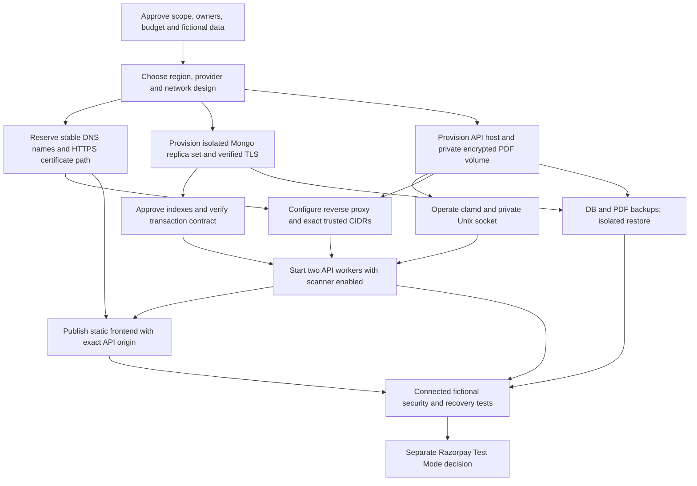

# Phase 17 — Staging infrastructure inventory and ownership plan

Assessment date: 2026-11-01. Repository branch `codex/physiocare-integration-2026-10-31`, committed baseline `5eaced696a156ca74233fd04252fea52345d8af8`. This is a **planning document only**. The uncommitted Phase 16 report and Razorpay guide correction are preserved. No staging resource, domain, account, scanner, payment endpoint or real MongoDB staging target was provisioned or contacted.

## Executive summary

**Staging status: BLOCKED. Production status: FAIL.** The repository contains a React/Vite static build, a Python 3.13 FastAPI API, Mongo/Beanie models and startup guards, private PDF quarantine, a Unix-socket ClamAV adapter, and Razorpay Test Mode source controls. Those are implementation assets, not deployed infrastructure. The only known connected database validation was the separately approved local Phase 15 transaction contract; it is not staging. The Phase 16 offline report recorded 531 backend and 59 frontend tests passing. Every cloud component and every operational role below remains unconfirmed.

Initial staging should use fictional data with payments and reconciliation disabled. Razorpay Test Mode must be a separate later approval: the present staging startup guard rejects payment configuration. The current PDF adapter requires the API and `clamd` to share a private Unix socket, and approved/quarantine directories to share a filesystem for atomic promotion. Arbitrary independent API replicas with local disks are not supported by that design.

## Proposed topology and status vocabulary

Conditional topology for review: static HTTPS frontend → HTTPS reverse proxy → two FastAPI workers on one controlled host → dedicated transaction-capable MongoDB over verified TLS. The API host also has encrypted private PDF storage and a co-located `clamd` daemon accessed only through a Unix socket. Secrets, logs, alerts, and backups are separately controlled. The topology is not selected or deployed. A single API host is a staging simplification and a failure domain; production needs another design/recovery decision.

`CODE` means an application control exists. `UNAVAILABLE` means no approved provisioned service was evidenced. `DEFERRED` means intentionally excluded from initial non-payment staging. All PASS checks below are **future acceptance criteria**, not results.

## Infrastructure inventory and measurable acceptance

| Component / purpose | Required configuration and dependencies | Security requirements and future PASS criterion | Complexity / cost feasibility / current state |
|---|---|---|---|
| **1. Frontend host** — serve static React build | Locked `npm ci`, production build, stable HTTPS origin; depends on DNS/certificate and API origin or an approved same-origin proxy. `VITE_API_URL` must be exact when cross-origin. | No secrets or patient data in the bundle; HTTPS and direct SPA routes work; browser calls only the approved API; exact CORS and cookies pass. | Low; free static hosting can fit a fictional staging build. **CODE; host UNAVAILABLE.** |
| **2. FastAPI host** — run API and two workers | Python 3.13, `backend/requirements.lock`, bounded workers/resources, private socket and persistent report paths; depends on host, secrets, Mongo, scanner and proxy. | Non-root service identity, restricted egress/ingress, no demo env; both workers start only with approved staging identity and reject unsafe config; restart does not expose or lose approved files. | High; 8 GiB VM is a sizing candidate, not a benchmark; free sleeping/ephemeral hosts are unsuitable for this gate. **CODE; host UNAVAILABLE.** |
| **3. Staging MongoDB** — persistent records and transactions | Empty, dedicated `physiocare_staging` replica set/cluster and least-privilege credential; indexes separately approved; depends on network, secret delivery and TLS identity. | No production/development data or shared account; exact host/DB verified; primary supports transaction rollback and concurrent claim; unique/TTL indexes verified; no unapproved collections. | Medium–high; free/Flex may support preliminary tests but feature limits must be proven. **CODE guard; cluster UNAVAILABLE.** |
| **4. Mongo TLS and hostname** — protect DB transport | Trusted CA chain, DNS name matching URI, explicit `tls=true`/`ssl=true`; depends on Mongo and trusted secret/CA delivery. | Valid chain/name connects; invalid CA, hostname, plaintext and bypass options all fail before usable DB access; capture only sanitized evidence. | Medium; often included with managed DB, self-managed certificates add work. **CODE guard; connected evidence UNAVAILABLE.** |
| **5. Private PDF storage** — clinical/lab quarantine and approved files | Separate directories under `STAGING_STORAGE_ROOT`, same filesystem per quarantine/approved pair, persistent encrypted volume; depends on API host, backup and retention decision. | Service-only 0700 dirs/0600 files; rejected/quarantined PDFs cannot be downloaded; promotion is atomic; restore reproduces DB-to-file references without exposing files publicly. | High; free ephemeral disks are unsuitable. **CODE; staging storage UNAVAILABLE.** |
| **6. ClamAV** — scan both PDF paths | Approved `clamd` version/image, maintained signatures, `StreamMaxLength`, resource limits and private absolute Unix socket; depends on API co-location, socket permissions, logs and alerts. | API user alone can access socket; bounded `PING` passes; approved EICAR fixture detected; clean PDF promotes; daemon outage/timeout rejects both upload paths; signature age alert fires. | High; scanner guidance calls for 3 GiB minimum/4 GiB preferred RAM. **Adapter CODE; daemon/socket UNAVAILABLE.** |
| **7. Reverse proxy** — trusted ingress | Exact proxy CIDRs in `TRUSTED_PROXY_NETWORKS`, forwarding-header overwrite, API binding on private interface; depends on host, TLS and DNS. | Untrusted direct headers cannot change throttle identity; only known ingress is trusted; direct API access blocked; rate-limit identity consistent across both workers. | Medium; VM proxy software has no separate license but requires operation. **CODE parsing; proxy UNAVAILABLE.** |
| **8. Public HTTPS API** — browser and future webhook ingress | Stable HTTPS API hostname, certificate renewal, TLS termination and exact CORS; depends on DNS/proxy. | Certificate SAN/expiry valid; HTTP redirects; HSTS and security headers reviewed; browser CSRF/Secure-cookie flow passes; no unsafe origin accepted. | Medium; public certificates can be free. **UNAVAILABLE.** |
| **9. Razorpay webhook endpoint** — later Test Mode callbacks | Exact `/api/webhooks/razorpay` HTTPS route, Test Mode secret and subscriptions; depends on separately approved payment environment, public HTTPS, DB indexes and monitoring. | Valid Test Mode signature accepted once; invalid signature, altered body, changed-header replay and conflicting header/body rejected; no live key/order/refund; sanitized logs. | Medium; endpoint code exists, provider operation **DEFERRED** and not compatible with current payment-disabled staging guard. |
| **10. Secrets management** — inject credentials | Per-environment access/refresh JWT keys, Mongo credential/CA, later payment secrets; depends on chosen host and owner access policy. | No secret in Git, frontend `VITE_*`, build, logs or report; limited role access, rotation and revocation demonstrated; staging and production values distinct. | Medium; provider env store may be low-cost, but access/audit/rotation must be checked. **Template CODE; service UNAVAILABLE.** |
| **11. Logs and monitoring** — detect failures | Restricted API/proxy/DB/scanner logs and alerts for health, scanner freshness, failed uploads, cleanup pending, disk and backup age; depends on all running components. | Fictional failure triggers alert to assigned responder; log sample contains no tokens, signatures, patient fields, file paths or PDF bytes; retention/access documented. | Medium; base logs may be included, durable alerting/storage may cost extra. **Partial code logging; operations UNAVAILABLE.** |
| **12. Backups and recovery** — restore DB and private PDFs | Encrypted DB snapshots plus file backups, independent restore destination and runbook; depends on DB, storage, secrets and retention owner. | Proposed staging target: daily backups no older than 24 h, isolated restore within 4 h, matching DB/file references and no real data. Owner must approve RPO/RTO before execution. | High; backup storage/egress extra. **UNAVAILABLE.** |
| **13. DNS/domain** — stable frontend/API names | Approved staging subdomains and ownership/renewal; depends on hosting choice. Provider-assigned names may suffice for early staging if stable and approved. | Resolved names point only to approved endpoints; certificates match; stale records removed; no production hostname reused. | Low; existing domain may avoid new purchase; registration/renewal price TBD. **UNASSIGNED/UNAVAILABLE.** |
| **14. Network controls** — isolate services | Firewall, private DB/scanner/storage access, restricted admin path and egress policy; depends on host, DB tier and proxy. | From untrusted source, DB/API-origin bypass, scanner socket and admin ports unreachable; only approved HTTPS ingress open; DB sees only approved API source; rule changes audited. | Medium–high; private endpoints can require dedicated DB tier and added fees. **UNAVAILABLE.** |

ClamAV memory guidance: [official Docker installation notes](https://docs.clamav.net/manual/Installing/Docker.html). MongoDB transactions require a replica-set-capable deployment: [production considerations](https://www.mongodb.com/docs/manual/core/transactions-production-consideration/). The application source controls are described in the [Phase 16 report](PHASE_16_OPERATIONAL_READINESS_REPORT.md), [Phase 15 scanner plan](PHASE_15_SCANNER_DEPLOYMENT.md), and [staging validation plan](PHASE_15_STAGING_VALIDATION.md).

## Operational ownership matrix

Every **actual person is UNASSIGNED**. These are proposed roles, not assignments. One person may hold multiple roles only after the project owner records the conflict-of-interest and recovery coverage.

| Role / actual owner | Decisions and required permissions | Operating duty and evidence | Recovery responsibility |
|---|---|---|---|
| Project owner — **UNASSIGNED** | Approve fictional-only scope, budget, hosting jurisdiction, clinic policies, RPO/RTO and go/no-go; read-only evidence access, not necessarily root credentials. | Maintain signed inventory, risk acceptance, data/retention policy and approval log. | Coordinate incident, authorize restore/rollback and notify stakeholders. |
| Backend operator — **UNASSIGNED** | Choose worker count, runtime limits and API configuration; deployment-scoped API access and non-secret diagnostics. | Review startup guard, auth, booking, report and health behavior; record two-worker and failure tests. | Roll back API release, isolate bad worker, reconcile pending work with database operator. |
| Frontend operator — **UNASSIGNED** | Choose approved frontend origin/build and CSP; static-host deploy rights only. | Verify bundle contains no secrets, exact API URL, SPA routes, CORS/cookie/browser workflows. | Revert static build and purge stale deployment/cache. |
| Database operator — **UNASSIGNED** | Approve exact empty cluster, DB identity, user grants, TLS CA, indexes and backups; DB admin rights scoped to staging. | Record cluster/version/primary, TLS, unique/TTL indexes, transaction and backup evidence without data dumps. | Restore to isolated target, repair access/indexes and coordinate data consistency. |
| Security/scanner operator — **UNASSIGNED** | Approve scanner version/signature source, socket mode, ingress trust, alert policy; scanner/proxy and security-log access. | Maintain FreshClam, signature-age alerts, EICAR/outage evidence, firewall and secret reviews. | Quarantine/disable unsafe uploads, rotate affected secrets, restore scanner safely. |
| Payment integration operator — **UNASSIGNED** | Separately approve Test Mode environment, key custody, webhook URL and event scope; Test Mode dashboard rights only. | Verify signatures, deduplication, retries and captured-payment review with fictional transactions. | Disable callback/checkout, reconcile test ledger and coordinate provider support; never handle live funds in this phase. |
| Deployment operator — **UNASSIGNED** | Approve change window, host/volume/proxy/DNS/certificate deployment access; no production rights required for staging. | Execute reviewed runbook, verify health/alerts and preserve sanitized deployment evidence. | Revert deployment, restore DNS/cert/proxy and coordinate backup recovery. |

## Dependency graph and deployment sequence

Order of work: (1) assign owners and approve inventory, budget, region, retention and fictional dataset; (2) select hosting/network and DNS/cert path; (3) create isolated Mongo with verified TLS and private storage; (4) operate scanner/socket and ingress; (5) inject secrets and start two API workers only after startup checks; (6) publish frontend; (7) verify observability and isolated backup restore; (8) run connected auth/proxy/report/cleanup matrix; (9) separately decide Test Mode design. No step is authorized by this document.

## Cost and provider comparison — estimates, not purchases

List prices checked 2026-11-01; USD monthly where quoted, before tax, domain, extra storage, backups, egress, support and operator time. They vary by region and plan. No provider or paid tier has been selected.

| Candidate | Verified public prices and estimated base | Fit and limit |
|---|---|---|
| Disposable student exploration: static Pages + OCI Always Free Arm + Atlas M0 | [Cloudflare Pages Free limits](https://developers.cloudflare.com/pages/platform/limits/) allow 500 builds/month; [Oracle Always Free](https://docs.oracle.com/en-us/iaas/Content/FreeTier/freetier_topic-Always_Free_Resources.htm) allows up to 2 OCPUs/12 GiB on A1 for Always Free tenancy; [Atlas M0](https://www.mongodb.com/docs/atlas/billing/atlas-flex-costs/) is no cost. **Estimated base $0** if capacity/eligibility exist. | Useful only for disposable rehearsal. OCI capacity may be unavailable; M0 and free hosting need transaction/index/backup capability proof; no assumption that all acceptance and recovery gates can pass. Never use real patient data. |
| Low-cost controlled VM + Atlas Flex + free static Pages | [DigitalOcean 8 GiB Basic VM $48/month](https://www.digitalocean.com/pricing/droplets) + [Atlas Flex $8–$30/month](https://www.mongodb.com/docs/atlas/billing/atlas-flex-costs/) + Pages Free = **estimated $56–$78/month base**. | Fits API + co-located scanner and durable local filesystem if the VM is adequately sized and backed up. [Flex lacks private endpoints, configurable failover test and continuous/PITR backups](https://www.mongodb.com/docs/atlas/reference/flex-limitations/); use only if approved network/restore requirements can be met by other controls. |
| More capable DB tier + controlled API host + free static Pages | DO 8 GiB VM $48/month + [Atlas dedicated M10 starts at $60/month](https://www.mongodb.com/docs/atlas/billing/atlas-flex-costs/) = **at least $108/month base**, plus backup, storage and network fees. | M10+ supports [private endpoints](https://www.mongodb.com/docs/atlas/security-private-endpoint/), but a DO VM cannot simply attach to an Atlas cloud-provider private endpoint; same-cloud compatible compute/network would need a separate quote. This arithmetic is a cost floor, not a validated private topology. |

[ClamAV recommends 3–4 GiB RAM](https://docs.clamav.net/manual/Installing/Docker.html), so an undersized free web service is not a reliable scanner host. [Render Free web services sleep and have ephemeral filesystems](https://render.com/docs/free), conflicting with scanner availability and private PDF durability. Public TLS certificates can be [free through Let's Encrypt](https://letsencrypt.org/docs/faq/), but DNS, renewal and ingress operation still need an owner. Any promotional/student credits must be verified for eligibility and expiration; they are not a security control.

## Security gates, risks and approvals

1. **Inventory approval:** project owner names actual operators, region, exact hosts/origins, data classification, budget cap, RPO/RTO, retention and fictional-data scope. None assigned yet.
2. **Provisioning approval:** deployment/database operators request exact host, network, DB, volume, DNS and certificate changes. Identify the vendor/system, billing effect and rollback before creating anything.
3. **Scanner approval:** security operator approves package/image digest, signature-update path, socket ownership and test corpus. A mode string or fake daemon does not count as operational scanning.
4. **Database mutation approval:** database operator verifies empty target and explicitly approves collection/index initialization and connected fictional tests; never reuse local `physiocare_dev`, the Phase 15 contract DB, or production data.
5. **Connected testing approval:** identify endpoints, fictional records, expected mutations, cleanup manifest and rollback; validate TLS, proxy, IDOR, two-worker throttling, transactions, scanner fail-closed, PDF privacy, cleanup and backup restore.
6. **Payment approval:** separate decision after non-payment staging; current staging guard forbids payment enablement. Test Mode needs an approved environment or a reviewed configuration-policy change. No live key, real charge or refund.
7. **Release decision:** independent security review, clinic policy, cost/owner signoff and verified restore/rollback before any production recommendation.

Critical blockers: no approved staging target, no operational scanner, no named operators, no verified TLS/proxy/backup path, no clinic policy, and no approved Test Mode design. Free-tier availability and Mongo feature limits could invalidate the cheapest option. Real patient data, cloud accounts, credentials and production systems remain outside this plan.

## Evidence and execution boundary

Source inspected: `backend/app/core/config.py`, `backend/staging.env.example`, `backend/app/main.py`, `backend/app/services/pdf_malware_scanner.py`, report storage/cleanup and payment service/routes, `frontend/src/services/api.js`, Phase 14–16 staging/security/architecture documents. This plan does not assert that any proposed infrastructure exists. It does not authorize installation, startup, cloud provisioning, database access, account creation, payment requests, domain registration, deployment, commit or push.
